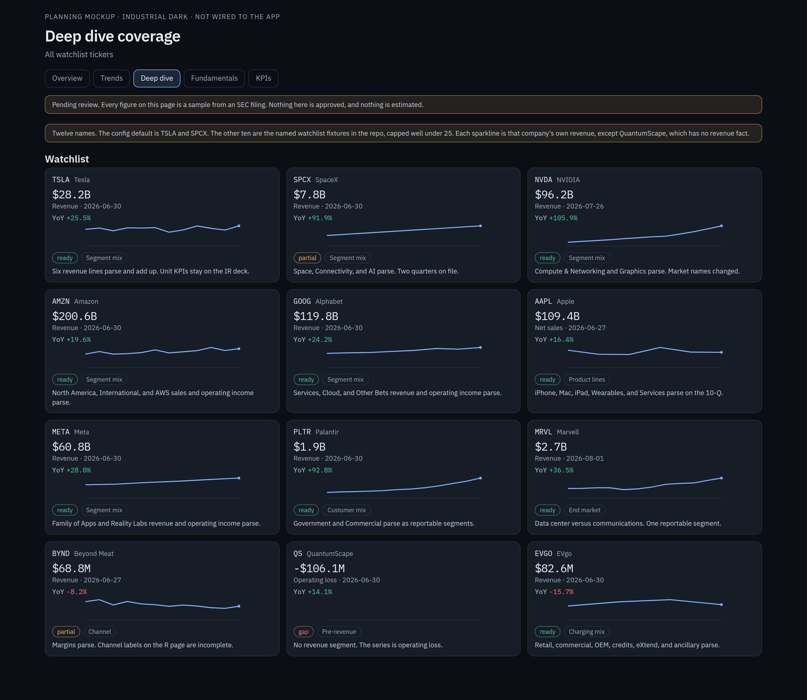
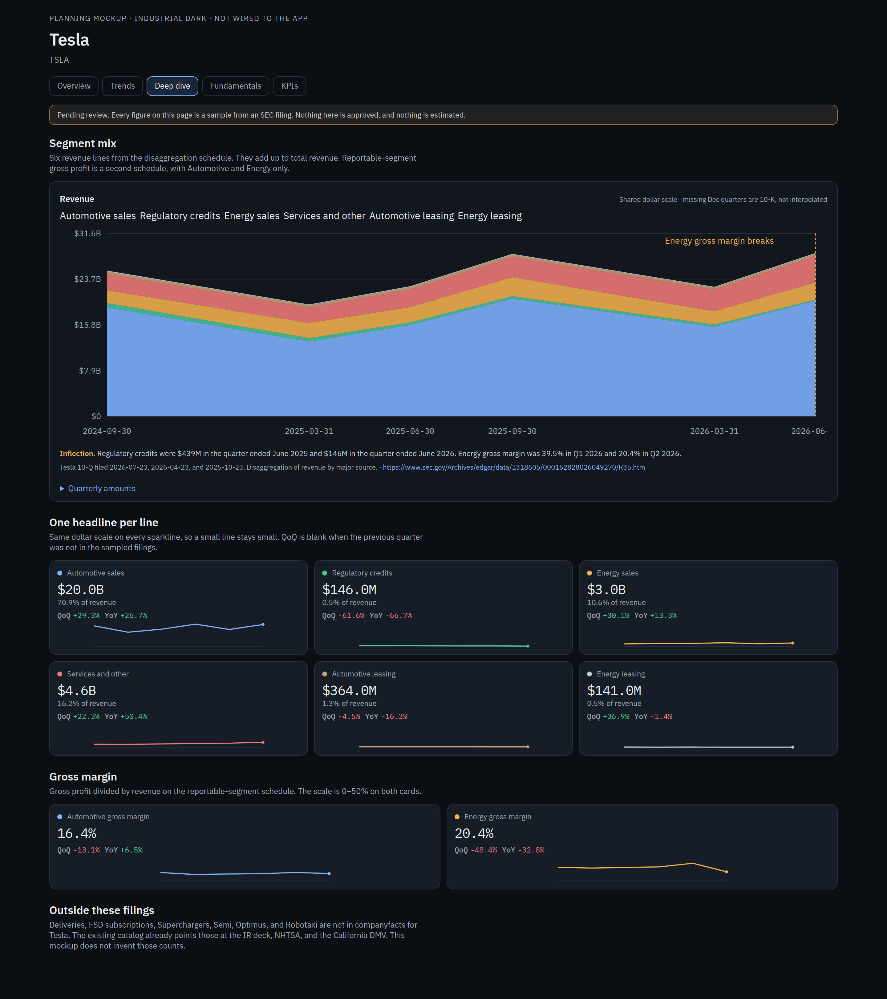
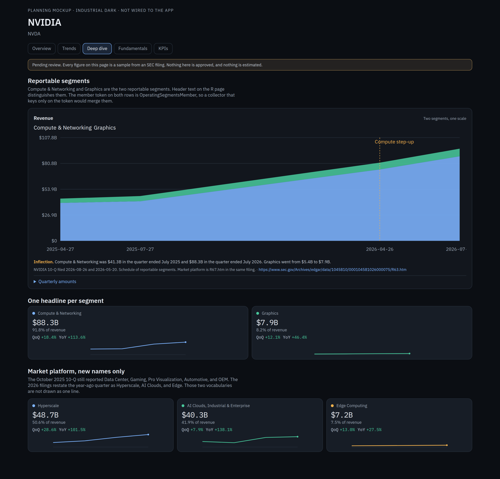
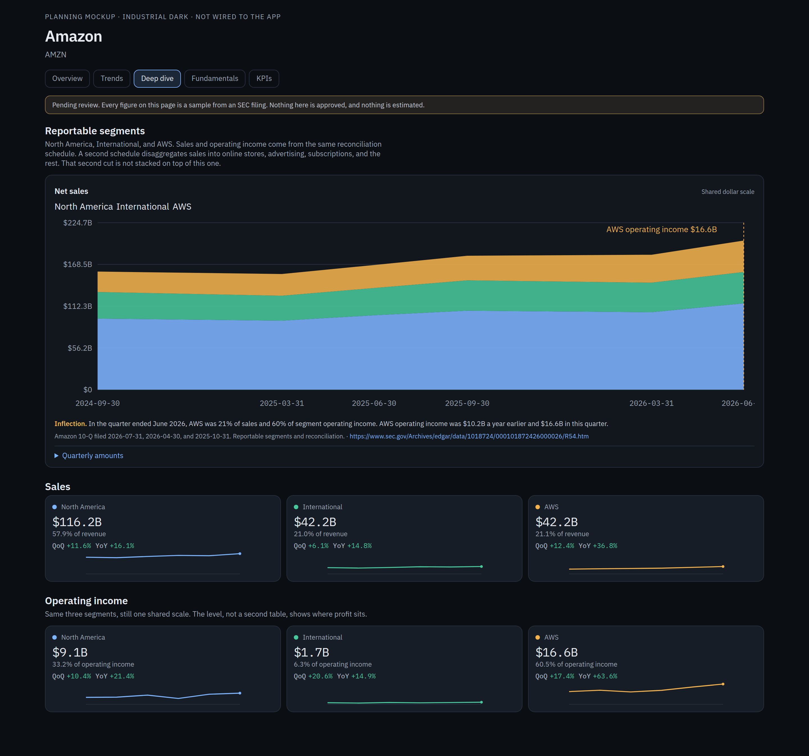
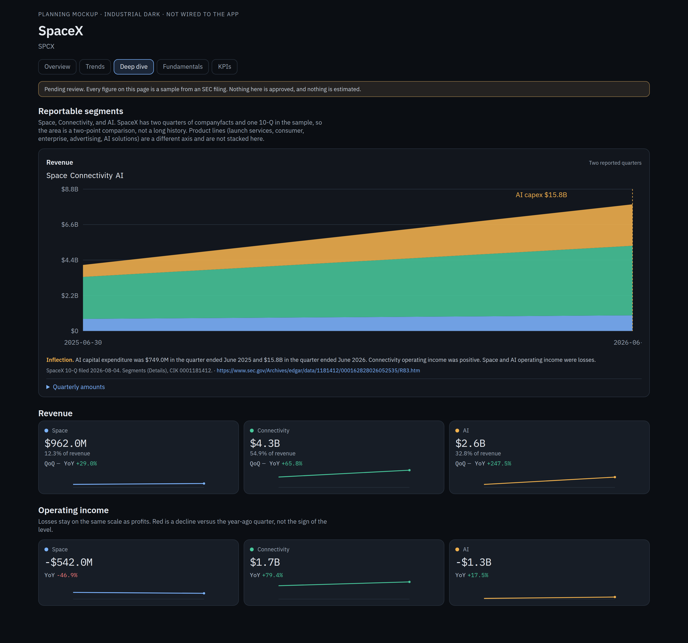
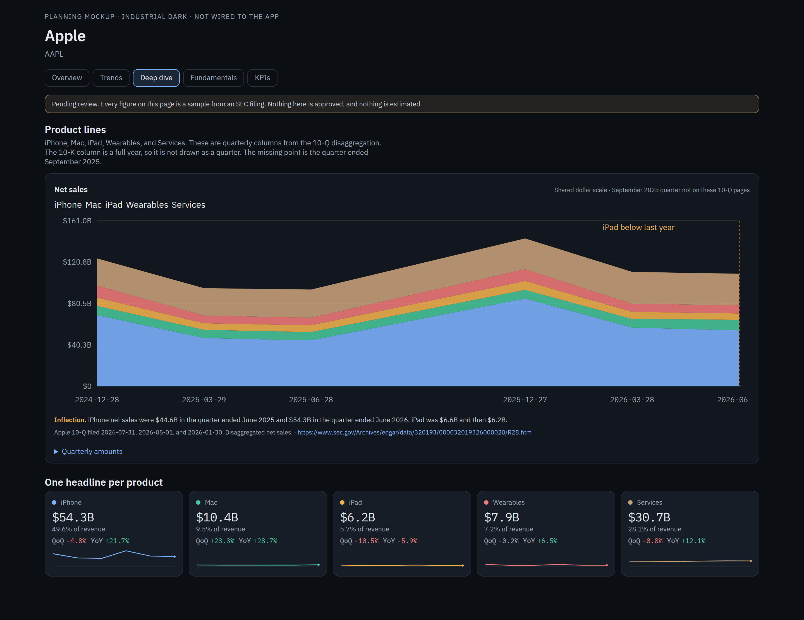

# Plan: Research for every watchlist ticker

Planning only. No production collector, UI, or admin changes. Figures below are samples pulled from EDGAR on 20 Oct 2026 with `User-Agent: InvestorDashboard research@example.com`. They stay proposed until a reviewer approves a catalog entry. This pass did not add an API key.

Static mockups, in the dashboard's Industrial Dark theme, are in [`mockups/`](mockups/). Screenshots are in [`screenshots/`](screenshots/). The series behind the charts are in [`samples.json`](samples.json).

## What Research is today

Research is a company-page tab (formerly labeled Deep dive). It renders only when `payload.deep_dive.sections` is non-empty. Packaged catalogs with a `deep_dive` block are TSLA and SPCX. NVDA has metrics and no research sections. Every other ticker gets generic GAAP rows only. The catalog field stays `deep_dive`.

Collectors are already source-keyed. `deep_dive.py` and `deep_dive_sources.py` do not name a ticker. The catalog supplies the reporting entity, Launch Library filter, CelesTrak prefix, news terms, and XBRL member map. Collected values stay proposed.

### Segments already tracked

**Tesla**

| Section | What it tracks |
|---|---|
| Robotaxi and autonomy | Fleet size, metros, driverless vs supervised fleet, Cybercab production and in-fleet count, paid miles, wait time, miles per vehicle |
| NHTSA SGO | ADS and ADAS incident-report counts, with a series break for the June 2025 threshold change |
| Commercial energy | Energy produced, storage deployed, Megapack vs Powerwall |
| Tesla Semi | Contracts, orders, production, cumulative production. Milestones: pilot fleet, Nevada factory, volume ramp, Megacharger network |
| Chargers | Supercharger stations and connectors, regional station counts, Megacharger sites, non-Tesla session share, site map |
| FSD | Subscriptions, take rate, and region splits (North America, China, Europe, APAC) |
| Production and deliveries | Total production, deliveries, Model 3/Y vs other models, days of supply |
| Optimus | Built, in use. Milestones: Gen 2, Gen 3, pilot line, volume line, external sales |
| Factories | Capacity. Milestones: announced, construction, start of production |
| Energy projects and news | Pipeline (announced, construction, commissioning) and a 90-day news-topic table |
| Public vehicle records | NHTSA recalls, complaints, investigations. California registered vehicles. AV permits from CA DMV, CPUC, and TxDMV |
| XBRL segments | Automotive, Energy generation and storage, Services and other |
| Forecast | Seasonal-naive placeholder. Labeled as not a model |

**SpaceX (SPCX)**

| Section | What it tracks |
|---|---|
| Launches | Total, Falcon 9, Falcon Heavy, Starship vehicle, mass to orbit, upcoming schedule |
| Projected launches | Launch Library schedule rolled forward |
| Terraform | Voice label. The program name is unconfirmed. Milestones only |
| Factories | Site milestones: announced, construction, production |
| Starship | Flights. Milestones: flight test, reuse, cadence |
| Starlink | Subscribers, ARPU, constellation size (CelesTrak GP), satellites built, satellites deployed (SATCAT) |
| Starmind | Voice label. May be Starshield. Production and deployed counts from news |
| AI deals | Counts tagged launch, Starlink, Starmind, Starship, AI |
| Revenue | Space, Connectivity, Starmind, Starship, AI, plus GAAP total |
| XBRL segments | Space, Connectivity, AI |
| Forecast | Same seasonal-naive placeholder |

Panel kinds the UI already draws: scoreboard, trend bars, small multiples, milestone timeline, diverging bars, US and world bubble maps, site map, forecast band, table. Secondary sections collapse.

## Watchlist this plan covers

The live watchlist is per user in DynamoDB, capped at 25 (`MAX_TICKERS_PER_USER`). It is not checked into the repo. The repo's own lists are:

- Config default, `BASE_TICKERS` in `services/data-jobs/src/app/universe.py`: **TSLA, SPCX**.
- The named `WATCHLIST` fixture in `services/data-jobs/tests/test_news_sentiment.py`: TSLA, SPCX, NVDA, AMZN, GOOG, AAPL, PLTR, QS, BYND, META, MRVL.
- The company-name map in `test_dashboard_build.py` (`SEC_NAMES`), which adds **EVGO**.

Union, 12 names, under the cap of 25:

`TSLA, SPCX, NVDA, AMZN, GOOG, AAPL, PLTR, QS, BYND, META, MRVL, EVGO`

Index proxies (SPY, QQQ, and the rest) are not companies and are out of scope.

## Archetypes

Five archetypes. A ticker section declares one. Collectors do not branch on the ticker.

| Archetype | What the panel shows | Collector |
|---|---|---|
| `segment_revenue_mix` | Stacked area of one XBRL axis, plus a headline, sparkline, and QoQ/YoY per member | FilingSummary R page |
| `unit_volumes` | Headline count, sparkline, deltas. Deliveries, launches, satellites, subscribers | Existing catalog source: IR exhibit, Launch Library, CelesTrak |
| `operating_kpis` | Same card, for rates and stocks that are not revenue. Stations, GWh, take rate, ARPU | IR exhibit or a keyless public file named in the catalog |
| `growth_margin` | Gross margin or operating income on the same member set, shared scale | Same R page, or companyfacts when the company has one segment |
| `public_records` | Counts from a regulator file. NHTSA, DMV, CPUC, state registrations | Existing `deep_dive_sources` readers |

A second axis (geography, product, end market) is a second section. It is never stacked on the first. Parent and child members are not stacked together.

## Ticker mapping, source, and a real sample

Latest period is the quarter end in the filing, not a forecast. Dollars are as reported.

| Ticker | Archetype | Segments to map | Source | Sample | Feasibility |
|---|---|---|---|---|---|
| TSLA | Mix, margin, then the existing unit and public-record sections | Automotive sales, regulatory credits, energy sales, services and other, automotive leasing, energy leasing. Reportable gross margin: Automotive, Energy | 10-Q disaggregation R page and the reportable-segment R page. CIK 0001318605 | Quarter ended 2026-06-30. Total revenue $28.236B. Automotive sales $20.006B, credits $146M, energy sales $2.998B, services $4.581B, auto leasing $364M, energy leasing $141M. Those six sum to the total. Energy gross margin 20.4% (was 39.5% in the quarter ended 2026-03-31) | Ready for mix and margin. Deliveries, FSD, chargers, Semi, Optimus, Robotaxi are absent from companyfacts. Keep the IR-deck and NHTSA/DMV collectors |
| SPCX | Mix and margin. Launches and Starlink stay unit volumes | Space, Connectivity, AI | 10-Q filed 2026-08-04, Segments (Details). CIK 0001181412 | Quarter ended 2026-06-30. Revenue $7.814B. Space $962M, Connectivity $4.291B, AI $2.561B. Operating income: Space -$542M, Connectivity $1.656B, AI -$1.257B. AI capex $15.828B vs $749M a year earlier | Ready for the three segments. History is two quarters. Launch, constellation, and subscriber series stay on Launch Library and CelesTrak. `CryptoAssetNumberOfUnits` (18,712 at 2026-06-30) is a companyfacts count and is not a Starlink count |
| NVDA | Mix. Market platform is a second section with a series break | Compute & Networking, Graphics. Market: Hyperscale, AI Clouds / Industrial / Enterprise, Edge | 10-Q filed 2026-08-26. Reportable segments and market platform. CIK 0001045810. Fiscal year ends in January | Quarter ended 2026-07-26 (FY2027 Q2). Revenue $96.221B. Compute & Networking $88.299B, Graphics $7.922B. Hyperscale $48.710B, AI Clouds $40.313B, Edge $7.198B | Ready. Both reportable rows carry the member token `OperatingSegmentsMember`. The header text is what separates them. The Oct 2025 10-Q still used Data Center, Gaming, Pro Visualization, Automotive, and OEM. Do not stitch that vocabulary onto Edge |
| AMZN | Mix and margin. Product disaggregation is a second section | North America, International, AWS | 10-Q reconciliation schedule. CIK 0001018724 | Quarter ended 2026-06-30. Sales: North America $116.177B, International $42.197B, AWS $42.232B. Operating income: $9.123B, $1.717B, $16.621B. AWS is 21% of sales and about 60% of segment operating income | Ready. Online stores, advertising, and subscriptions are a different axis (they also sum to total sales) and need their own section |
| GOOG | Mix and margin | Google Services, Google Cloud, Other Bets, plus a corporate reconciling line | 10-Q segment schedule. CIK 0001652044 | Quarter ended 2026-06-30. Revenue: Services $94.540B, Cloud $24.768B, Other Bets $382M, total $119.796B. Operating income: Services $39.544B, Cloud $8.814B, corporate -$5.789B | Ready |
| AAPL | Product mix | iPhone, Mac, iPad, Wearables, Services. Geography (Americas, Europe, Greater China, Japan, Rest of Asia Pacific) is a second section on the 10-K | 10-Q disaggregated net sales. CIK 0000320193. Fiscal year ends in September | Quarter ended 2026-06-27 (FY2026 Q3). Net sales $109.417B. iPhone $54.252B, Mac $10.352B, iPad $6.191B, Wearables $7.883B, Services $30.739B | Ready on the 10-Q. companyfacts has quarterly revenue under `RevenueFromContractWithCustomerExcludingAssessedTax` ($109.417B). A collector that stops at the first tag named `Revenues` records nothing, because that tag has no quarterly rows |
| META | Mix and margin | Family of Apps, Reality Labs | 10-Q segment schedule. CIK 0001326801 | Quarter ended 2026-06-30. Revenue $60.801B. Family of Apps $60.370B revenue and $23.394B operating income. Reality Labs revenue $431M. Consolidated operating income $18.775B | Revenue mix is ready. The Reality Labs operating-income row did not parse in this pass (the Family of Apps income row did). Treat RL margin as partial until the row parser keeps it |
| PLTR | Customer mix | Government, Commercial | 10-Q reportable-segment schedule. CIK 0001321655 | Quarter ended 2026-06-30. Revenue $1.935B. Government $990M, Commercial $945M. Header text splits them. Both rows use `OperatingSegmentsMember` | Ready, with the same header-label rule as NVIDIA. Geography (US vs rest of world) is a separate report and a separate section |
| MRVL | End market, plus company-level margin | Data center, Communications and other. One reportable segment | 10-Q net revenue by end market. CIK 0001835632. Fiscal year ends in January | Quarter ended 2026-08-01. Revenue $2.739B. Data center $2.172B, communications and other $568M. Operating income $460M from companyfacts | Ready for the end-market mix. There is no multi-segment operating income to chart |
| BYND | Company margin. Channel mix is partial | US vs international, and retail vs foodservice, once labels stick | companyfacts, plus the 10-K "Net Revenues by Platform and Channel" R page. CIK 0001655210 | Quarter ended 2026-06-27. Revenue $68.8M, gross profit $5.9M, operating loss -$30.8M. The annual channel page has numeric rows ($275.5M net revenue for 2025) but several lines have no member token | Margins are ready. Channel panels wait until the parser keeps unlabeled rows and a reviewer maps them |
| QS | Growth and margin only | No revenue segment | companyfacts. CIK 0001811414 (QuantumScape Corp) | Quarter ended 2026-06-30. Operating loss -$106.1M. No revenue tag in companyfacts. FilingSummary has no segment-revenue report | Gap for mix and unit volumes. Show the operating-loss series and an explicit empty state for segments |
| EVGO | Charging mix | Charging network (retail, commercial, OEM, regulatory credits, OEM network) and non-charging (eXtend, ancillary) | 10-Q disaggregation. CIK 0001821159 | Quarter ended 2026-06-30. Revenue $82.6M. Charging network $61.4M, of which retail $37.8M. eXtend $18.0M. Children sum to their parents, and the two parents sum to total revenue | Ready if the catalog marks parents and children. companyfacts `Revenues` stops in 2023. The live quarterly tag is `RevenueFromContractWithCustomerExcludingAssessedTax` |

## How the samples were collected

1. `https://www.sec.gov/files/company_tickers.json` for the CIK.
2. `https://data.sec.gov/submissions/CIK##########.json` for the latest 10-K and 10-Qs.
3. `https://data.sec.gov/api/xbrl/companyfacts/CIK##########.json` for consolidated revenue, gross profit, and operating income.
4. `FilingSummary.xml` in the filing folder, then the R page whose ShortName scored as a segment report.

SPCX resolves. It is a filer. CIK 0001181412, `SPACE EXPLORATION TECHNOLOGIES CORP`.

Two collector bugs showed up while pulling samples. Both are catalog or parser fixes, not new sources.

- The first tag that merely exists wins today. For Apple, Meta, and EVgo that tag is a stale or empty `Revenues`. The quarterly series lives on `RevenueFromContractWithCustomerExcludingAssessedTax`. Pick the tag with the newest quarter.
- A 10-K/A can be the newest 10-K and can have no FilingSummary reports. Tesla's amendment was that case. Skip a filing whose summary does not contain the catalog report, and read the original 10-K or the 10-Q.

Company IR sites were not a second numeric source in this pass. Tesla's catalog already says EDGAR EX-99.1 is the machine-readable release and the IR PDF is a fallback. Segment dollars for every filer in this set are on the R pages. Unit counts that are not in XBRL stay on the collectors the catalog already names.

## Architecture

```
watchlist (prefs, cap 25)
        │
        ▼
catalog/<T>.json
  deep_dive.sections[]          archetype, headline metric, axis id
  deep_dive.sources[]           existing source id + entity / prefix / terms
  xbrl_segments.axes[]          one section per axis
  xbrl_segments.reports[]       ShortName patterns, not a single exact string
  xbrl_segments.members{}       member token + header label -> metric_id
  xbrl_segments.parents[]       members that must not be stacked with their children
        │
        ▼
collectors (no ticker literals)
  sec_companyfacts     consolidated GAAP, newest-quarter tag
  sec_segment_r        FilingSummary + R page, already in company_ir.py
  nhtsa_sgo / nhtsa_odi / av_regulator / state_registrations
  launch_library / celestrak
  news_topics / news_estimates
  ir exhibit           existing company_ir path, EX-99.1 first
        │
        ▼
serving/stock/<T>.json  deep_dive block, values still proposed
        │
        ▼
deep-dive.js             one renderer per archetype
```

Rules:

- A new ticker is a catalog file. Collectors, panel kinds, and the frontend gain no `if ticker ==` branch.
- One axis per stacked area. Product and geography do not share a chart.
- Parent members are headings or their own chart, not slices beside their children.
- When several rows share `OperatingSegmentsMember`, the metric id comes from the header label (`Compute & Networking`, `Government`).
- A change in member vocabulary is a series break on the section, the same idea as the existing NHTSA SGO break. NVIDIA's market names are the example.
- Q4 that exists only as a full year stays blank on the mix chart until the 10-K quarterly column is collected. The fundamentals job already derives a Q4 for consolidated GAAP. A derived segment Q4 would be labeled derived. This plan does not invent one.
- Approval stays where it is. Nothing in the collector sets `approved`.

## Panel design

The mockups follow the current theme (`--page #0b0e13`, `--surface #12161d`, IBM Plex, green `#48c79b`, red `#f07a7a`, blue `#7db4ff`, amber `#f2b24e`). The tab row matches a company page that is not a fund: Overview, Analysis, Research, Fundamentals, KPIs. A fund also has a Fund tab after Analysis and does not show Fundamentals or KPIs.

Each segment section:

1. One stacked area for the mix, on a single dollar scale. Gridlines are labeled. A missing quarter is a gap, not a bridge.
2. An amber annotation on the inflection the series actually shows.
3. Small multiples underneath. Each card is a name, one headline number, a sparkline, QoQ, and YoY. Every sparkline in the row uses the same scale, so a $146M line does not look like a $20B line. QoQ is blank when the previous quarter is not in the sample.
4. Share of the section total sits under the headline.
5. The quarterly table is a closed `<details>` control. The screenshot shows it closed.
6. The filing, the report ShortName, and the archive URL sit on the panel.

Pages rendered:

| File | What it demonstrates |
|---|---|
| [overview.html](mockups/overview.html) | All 12 tickers. Own sparkline, YoY, archetype, feasibility |
| [tsla.html](mockups/tsla.html) | Six-line mix, shared scale, energy gross-margin break, credits down 66.7% YoY |
| [nvda.html](mockups/nvda.html) | Two reportable segments, plus the new market names kept off the old Gaming series |
| [amzn.html](mockups/amzn.html) | Sales mix and a second row of operating income on one scale |
| [spcx.html](mockups/spcx.html) | Three segments, two quarters, losses and profits on one scale, AI capex annotation |
| [aapl.html](mockups/aapl.html) | Five product lines. The September 2025 quarter is absent because the 10-K column is a full year |

Screenshots:








## Rollout

The work is sequential because each phase uses the catalog shape from the phase before it. No phase edits the admin tab.

1. **Catalog only.** Add `deep_dive` and `xbrl_segments` for the 12 tickers, status `proposed`. Map the members in the table above. Mark parents. Record the NVIDIA market series break. Leave QS with an explicit empty mix section. Do not approve anything.
2. **Parser fixes, still proposed.** Newest-quarter companyfacts tag. Skip a 10-K/A with no FilingSummary match. Read the header label when the member token repeats. Keep a row that has a label and a number even when the member token is empty, and leave it unmapped until the catalog names it (Beyond Meat).
3. **Two panel kinds.** `stacked-area` and a headline card with sparkline and deltas, rendered by archetype from the catalog. Reuse the current small-multiples and collapsed-secondary patterns. Wire no new route.
4. **Unit volumes and public records for tickers that already have a keyless source.** Tesla keeps NHTSA, DMV, and the earnings exhibit. SpaceX keeps Launch Library and CelesTrak. Other tickers get a public-record section only when a catalog source id already exists. No new API key, and no scrape of an IR HTML page that is not already an EX-99.1 exhibit.

After phase 2, a reviewer can open any of the ready tickers and see real segment dollars with a pending-review banner. The mockups are the target for that screen.
